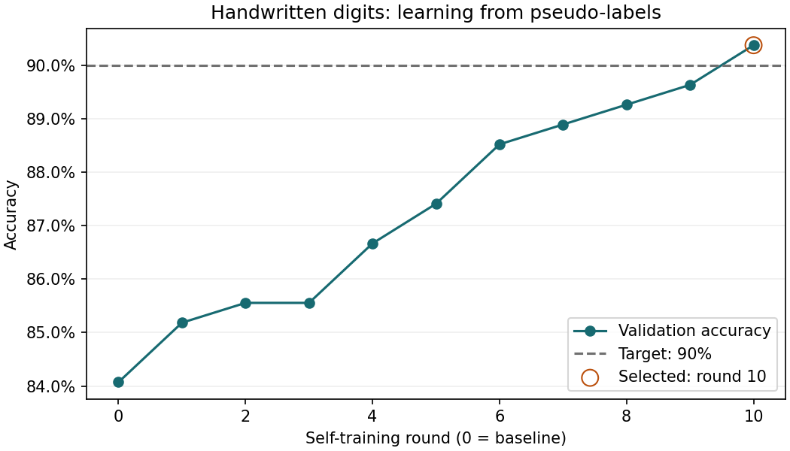

# HW2：用 50 张标注图片训练手写数字识别器

本项目选择作业二的 **b）自己做一个简单的 RSL 系统**，用半监督学习中的**伪标签自训练**实现循环：模型先识别未标注图片，把最有把握的预测加入训练集，再训练下一轮模型。实验的目标是让**验证准确率达到 90%**。只用 CPU，安装依赖后可离线运行。

## 复现

在仓库根目录运行。以下命令适用于 Linux / macOS；实验使用 Python 3.13.5。

```bash
python3 -m venv .venv
source .venv/bin/activate
python -m pip install -r requirements.txt
python train.py
```

默认随机种子为 42。最后一行应显示 `Test: baseline=85.00%, selected=86.39%`。输出写到 `results/`；比较其他参数时可指定新目录，保留默认实验。例如，下面的命令只看验证集，观察提高伪标签门槛后每轮能选中多少图片：

```bash
python train.py --threshold 0.99 --validation-only --output runs/threshold-099
```

## 模型怎样从自己的预测中学习？

使用 scikit-learn 自带的 [Digits 数据集](https://scikit-learn.org/stable/modules/generated/sklearn.datasets.load_digits.html)：1,797 张 8×8 的手写数字灰度图，类别是 0 到 9。先按类别比例留出验证集和测试集，再从剩余图片中为每个数字随机抽取 5 张作为已标注样本。

| 用途 | 图片数 | 何时使用答案 |
| --- | ---: | --- |
| 初始训练集 | 50 | 每个数字 5 个真标签，所有轮次都保留 |
| 未标注池 | 1,117 | 学习循环只收到像素，不接收真标签 |
| 验证集 | 270 | 每轮评估，用于停止和选择模型 |
| 测试集 | 360 | 选定模型后才评估，比较基线与自学习模型 |

1. **第 0 轮：** 把图片的 64 个像素作为特征，用 50 张已标注图片训练多分类逻辑回归，得到基线模型。
2. **选伪标签：** 当前模型给未标注池中的每张图预测类别和概率。以预测概率最高的类别作为伪标签；概率达到 0.90 才有资格入选。按预测类别分组，每个数字最多取置信度最高的 5 张，避免某个容易识别的类别占满一轮。比如一张图被预测为 7 且概率为 0.98，它可以进入数字 7 的候选组。
3. **更新参数：** 将入选图片和伪标签加入累计训练集，并从未标注池移走，防止重复使用。用全部累计样本重新拟合模型，更新每个类别的像素权重和截距。新模型负责下一轮预测。置信度门槛和逻辑回归的正则化参数（`C=0.1`）保持不变。
4. **反馈与停止：** 每轮验证后保留准确率最高的模型，平分保留较早轮次。验证准确率达到 90%、没有合格候选、未标注池用尽，或完成 10 轮更新时停止。

## 实验结果

| 模型 | 真标签 + 伪标签 | 验证准确率 | 测试准确率 |
| --- | ---: | ---: | ---: |
| 第 0 轮：仅人工标注 | 50 + 0 | 84.07%（227/270） | 85.00%（306/360） |
| 第 10 轮：验证集选出的模型 | 50 + 500 | 90.37%（244/270） | 86.39%（311/360） |



第 10 轮首次达到验证目标。相同测试集上，最终模型比基线多答对 **5 张**，提高 **1.39 个百分点**。这说明在本次固定划分上，增加伪标签有帮助；验证集上的提升没有全部转移到测试集。高置信度预测仍可能出错，错误标签也会参与下一轮训练，因此这一次结果不能保证其他随机种子或数据集也有相同收益。

## 仓库内容

| 文件 | 用途 |
| --- | --- |
| [train.py](train.py) | 数据划分、伪标签选择、训练循环、最终评估和绘图 |
| [requirements.txt](requirements.txt) | 实验依赖及版本 |
| [results/history.csv](results/history.csv) | 每轮新增、累计训练、剩余未标注样本数及验证准确率 |
| [results/summary.json](results/summary.json) | 配置、停止原因、最佳轮次和基线对照 |
| [results/best_model.joblib](results/best_model.joblib) | 验证集选出的模型，可用 `joblib.load` 加载；输入为每张图片的 64 个像素值（0–16） |
